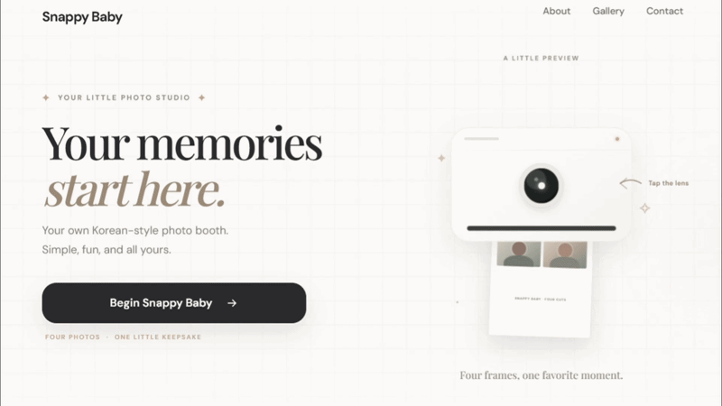

<p align="center">
  
</p>

# 📸 Snappy Baby

A modern Korean-style web photobooth built with HTML, CSS, and JavaScript.

## ✨ Features

- 📷 Live camera preview
- ❤️ Red lighting filter
- 🖼️ Photo strip printing animation
- 🎨 Korean photobooth inspired UI
- 💾 Download photo strips

## 🛠️ Built With

- HTML5
- CSS3
- JavaScript
- Node.js

## 🚀 Getting Started

1. Clone the repository

```bash
git clone https://github.com/ranzxgit/Snappy-baby.git
```

2. Install dependencies

```bash
npm install
```

3. Start the server

```bash
node server.mjs
```

4. Open your browser

```
http://localhost:4173
```

## 📄 License

MIT